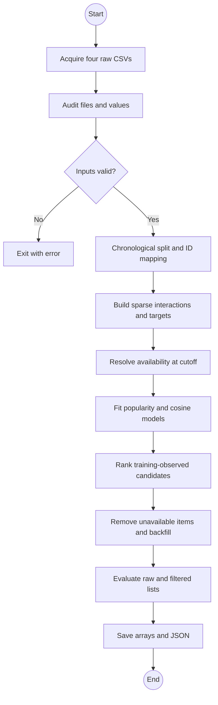
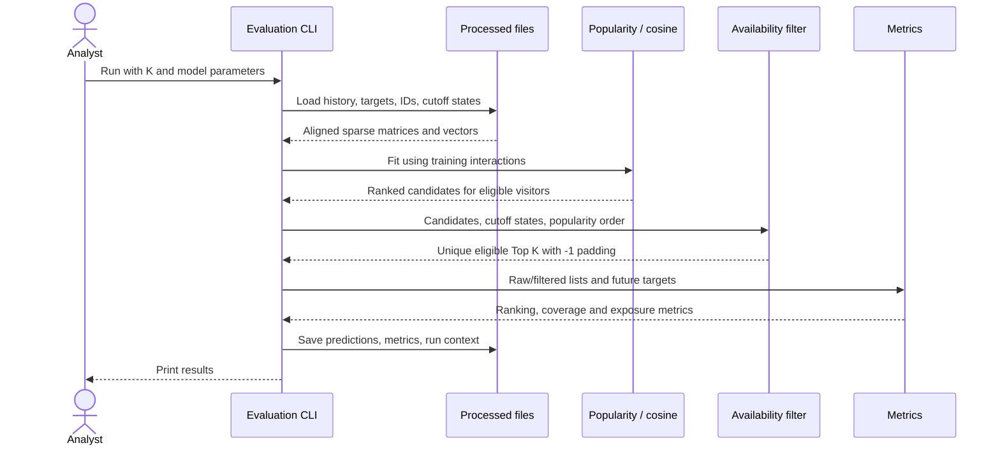
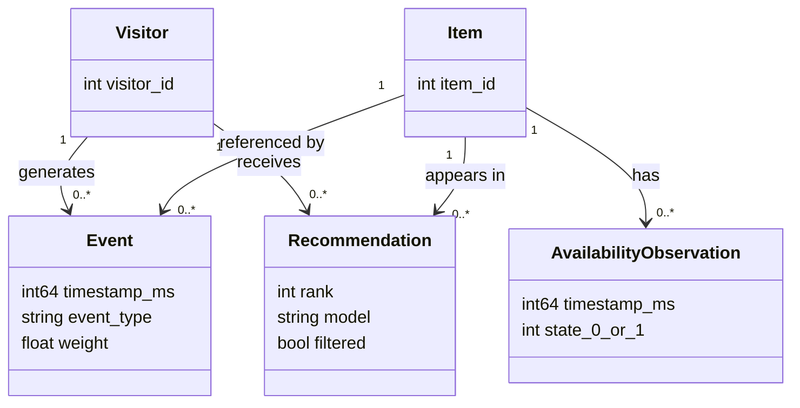

# Availability-Aware E-Commerce Recommendation: Specification Draft

Revision: 2026-11-16. This is editable source for the project-update spec. The final spec must be typeset within four pages; this Markdown draft has not been page-count validated. Work distribution has been confirmed by Ang Li. Exactly FR-1 to FR-3, NFR-1 to NFR-3, U-1 to U-3, and F-1 to F-3 below are selected for grading.

## 1. Background, goal, and scope

E-commerce recommenders may recommend products that are unavailable. This project compares popularity and item-based cosine recommendations using Retailrocket behavior logs, then measures the relevance and availability trade-off when known-unavailable products are removed. The implementation uses a chronological split, weighted implicit interactions, a historical availability snapshot, and offline ranking metrics.

**In scope:** local CSV audit and preprocessing; popularity and item-based cosine models; cutoff-based availability filtering; repeat-item recommendations; ranking, coverage, exposure, and runtime evaluation; reproducible command-line outputs and automated tests.

**Out of scope:** a deployed storefront, real-time inventory, physical stock quantities, causal revenue estimates, live A/B tests, user authentication, category-aware ranking, and recommendations for visitors without training history. Views, carts, and purchases all count as future targets; purchase prediction alone is not the objective.

**Work distribution:** Ang Li confirmed that the following tasks were completed by the named members. These assignments describe each member's project responsibilities; the current draft incorporates subsequent local review updates.

| Responsibility | Member(s) | Concrete deliverables |
| --- | --- | --- |
| Select the dataset and baseline models | Ang Li | Retailrocket dataset and the popularity and item-based cosine baselines |
| Describe the software architecture | Ang Li | Architecture description, component relationships, and system diagrams |
| Prepare a test plan | Ang Li | Test cases, inputs, expected results, preconditions and postconditions |
| Measure how each step scales (do not guess) | Wuxuan Wang | Empirical measurements of pipeline stages at different input sizes |
| Build a working skeleton | Wuxuan Wang | A runnable initial implementation connecting the main pipeline stages |
| Prepare a specification | Abby Li | Project specification, scope, requirements, and constraints |

## 2. Requirements and acceptance criteria

All six selected requirements are **Must / stable for this update**. IDs provide traceability across code, tests, and progress reporting. Values such as K, candidate count, and neighbor count remain configurable without changing a requirement ID.

| ID | Verifiable requirement | Implementation / verification |
| --- | --- | --- |
| FR-1 | For valid Retailrocket CSVs and a train fraction in `[0.5,1)`, create weighted CSR training interactions (view=1, addtocart=3, transaction=5), binary distinct future targets, sorted ID mappings, cutoff availability, and metadata. Use `timestamp <= cutoff` for training and `> cutoff` for testing. Reject a split with an empty partition. | `prepare_data.py`; F-1 and timestamp-tie regression |
| FR-2 | For each visitor with history and future targets, produce popularity and item-based cosine lists of K unique training-observed items, allowing previously seen items. Filter known-unavailable items, retain unknown states, backfill by training popularity, and use `-1` when fewer than K eligible items exist. | `recommendation_models.py`; U-2, F-2 |
| FR-3 | Save both models' raw and filtered Recall@K, NDCG@K, catalog coverage, unavailable/unknown exposure, filled-slot count, and runtime as JSON, plus item-ID arrays and evaluated-user indices. Include K, candidate count, neighbor count, thread count, cutoff and library versions in shared context. | `evaluate`, `save_model_results`, CLI; U-3, F-2 |
| NFR-1 | Enforce temporal integrity: training scores and candidate membership use only pre-cutoff events, and each availability state is the latest same-item record at or before the cutoff. Later states must not affect that snapshot; no earlier state means unknown. | `asof_indices`, `popularity_ranking`; U-1, F-1, F-2 |
| NFR-2 | Preserve output integrity: training/target matrices share the ID mapping, arrays have exactly K columns, recommendation IDs are unique per row excluding `-1`, and filtered known-unavailable exposure is zero. Invalid CLI ranges and missing required raw files must return nonzero status. | Preparation/evaluation CLI; F-1, F-2, F-3 |
| NFR-3 | Support a documented local workflow with pinned dependency versions, no-network fixture tests, and saved run parameters/environment. Store interaction matrices sparsely and keep raw data, full processed artifacts, and full recommendation outputs outside Git; small evidence JSON may be tracked. | README, lock file, `.gitignore`; F-1/F-2 plus repository/environment inspection |

## 3. Data model, schema, and storage

Rows are anonymized visitor events or timestamped item-property observations, not inventory quantities. Raw CSVs live in `data/raw/retailrocket/`. Numeric identifiers retain their dataset values; matrix mappings use sorted int32 IDs, timestamps use int64 milliseconds, and interaction weights use float32.

| File / representation | Row and column definitions | Use |
| --- | --- | --- |
| `events.csv` | One event: `timestamp` (Unix ms), `visitorid` (visitor ID), `event` (view/addtocart/transaction), `itemid` (item ID), nullable `transactionid` (transaction ID) | Behavioral history and future labels; transaction ID is not a feature |
| `item_properties_part1/2.csv` | One property observation: `timestamp` (Unix ms), `itemid`, `property` (name/encoded property), `value` (string) | `available` values 0/1 supply historical availability; `categoryid` values are audited; other properties are unused |
| `category_tree.csv` | One category: `categoryid`, nullable `parentid` | Category-membership audit only |
| `user_ids.npy`, `item_ids.npy` | Sorted IDs; array positions define matrix rows/columns | Map original identifiers to sparse indices and back |
| `train_interactions.npz` | CSR, shape users x items; repeated train events sum their weights | Model input |
| `test_targets.npz` | CSR with same shape; unique future visitor-item pairs have value 1 | Relevance labels |
| `availability_at_cutoff.npy` | int8 vector aligned with item IDs; 0 unavailable, 1 available, -1 unknown | Filtering and exposure metrics |
| `metadata.json` | Counts, cutoff, weights, sparsity summaries, state coverage and preparation runtime | Data lineage |
| Model output directory | `user_indices.npy` indexes `user_ids.npy`; raw/filtered recommendation arrays store original item IDs or -1; `metrics.json` stores measures | Inspectable predictions and evaluation |

**Assumptions and constraints:** cutoff time is the requested timestamp quantile; ties remain together, so the exact event ratio may differ from the requested ratio. Availability is fixed at the cutoff for the entire test period. Inputs are expected to have consistent IDs, integer millisecond timestamps, and no contradictory same-item availability observations at the same timestamp. Unknown states remain eligible. Candidate items require training evidence, but ID mappings and the catalog-coverage denominator include all observed event items, including future-only items. Recall and NDCG retain all future target items in the denominator. Only visitors with both history and future targets are evaluated. Implicit interactions are not explicit preferences, and offline metrics cannot establish sales effects.

## 4. Architecture: three UML diagram types

### A. Activity diagram: offline processing flow

**Description:** shows the command-line workflow and the invalid-input branch from acquisition through saved evaluation. **Why this type:** activity diagrams make processing order and decisions visible. Traces FR-1, FR-2, FR-3 and NFR-2.

### B. Sequence diagram: recommendation and availability interaction

**Description:** shows how model ranking, availability policy, and evaluation exchange data. **Why this type:** sequence diagrams expose the order in which training inputs and future labels are used; targets are supplied to evaluation, not model fitting. Traces FR-2, FR-3 and NFR-1.

### C. Class diagram: logical domain data model

**Description:** defines entity relationships and cardinalities; availability is a series of observations rather than a permanent item field. These are logical entities represented by CSVs/arrays, not Python classes. **Why this type:** a class diagram clarifies identifiers, relationships, and the schema independently of the procedural code. Traces FR-1 and NFR-2.

## 5. Selected test cases

All selected cases are automated. Preconditions include installed dependencies; each functional case uses an isolated temporary directory and synthetic CSVs, and cleans it up afterward. The current pass/fail evidence is recorded in `project_update.md`.

| ID / requirement | Preconditions; inputs and steps | Expected results and postconditions |
| --- | --- | --- |
| U-1 / NFR-1 | Sorted availability history: item 10 at t=100/300; item 20 at t=200. Call `asof_indices` for (10,99), (10,200), (20,250), (30,250). | Indices `[-1,0,2,-1]`; future states and other-item states cannot match. Inputs unchanged; no files written. `test_asof_join_uses_only_state_at_or_before_query_time` |
| U-2 / FR-2 | States `[0,1,-1,1]`, candidates `[0,2]`, popularity `[0,1,2,3]`, K=3. Run the filter. | `[2,1,3]`: known-unavailable item removed, unknown retained, popularity fills slots without duplication. Inputs unchanged; no files written. `test_filter_excludes_known_unavailable_and_keeps_unknown` |
| U-3 / FR-3 | One visitor targets items 1 and 3. Evaluate `[1,0,3]` at K=3, then `[-1,1]` at K=2. | First recall=1 and NDCG=`1.5/(1+1/log2(3))`; padded recall=0.5 and NDCG=`(1/log2(3))/(1+1/log2(3))`. Empty positions retain their rank and are excluded from slot/exposure counts. No files written. `test_metrics_use_original_rank_and_known_relevance` |
| F-1 / FR-1, NFR-1/2/3 | Ten unsorted fixture events, two visitors, five items, two property files and a category tree. Copy with offline downloader, audit, prepare at default 80%. | Exit 0; cutoff=72, train/test=8/2, training catalog=4; exact matrices match fixture; states `[1,0,-1,1,1]` ignore changes at 75/85. All processed files persist until cleanup. `test_f01_offline_acquisition_audit_and_temporal_preparation` |
| F-2 / FR-2/3, NFR-1/2/3 | Use F-1 fixture; run both models with K=6, candidate count=8, neighbors=2, threads=1. | Exit 0; both models save 2x6 arrays. Raw contains items {10,20,30,40}, filtered {10,30,40}; all other slots=-1. Item 50 is future-only and absent. Raw recall=0.5, filtered recall=0; filtered unavailable exposure=0. Parameters and environment saved. `test_f02_two_model_evaluation_with_small_catalog` |
| F-3 / NFR-2 | Fresh fixture and no result directory. Run prepare with fraction=1; run model with K=10/candidates=5; remove events.csv and run audit. | Each command exits nonzero with an explanatory error. No evaluation summary is created. Temporary fixture remains isolated. `test_f03_invalid_inputs_fail_without_success_metrics` |

Additional regression tests cover CSV blank lines/missing trailing newline, empty data, unknown events, duplicate recommendations, all-unavailable catalogs, popularity ties, timestamp ties and visitors without overlapping history/targets. These are supporting tests, not additional cases selected for grading.
